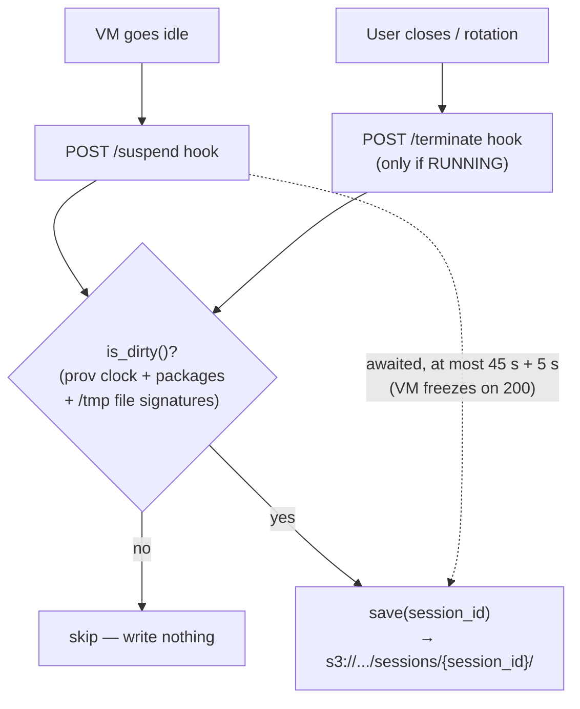
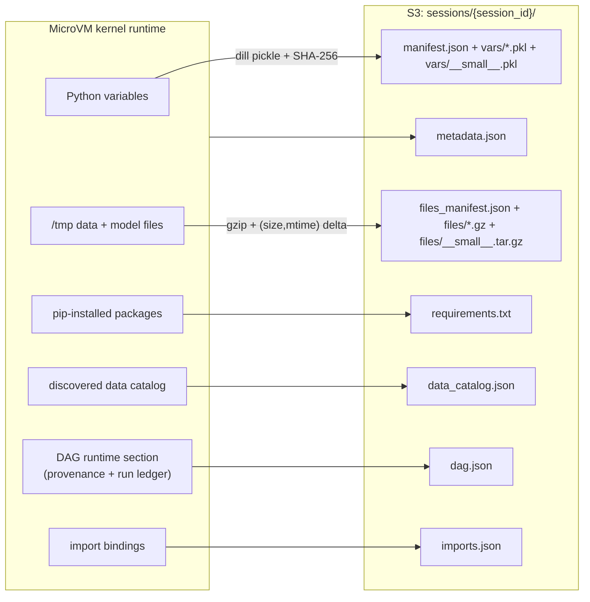
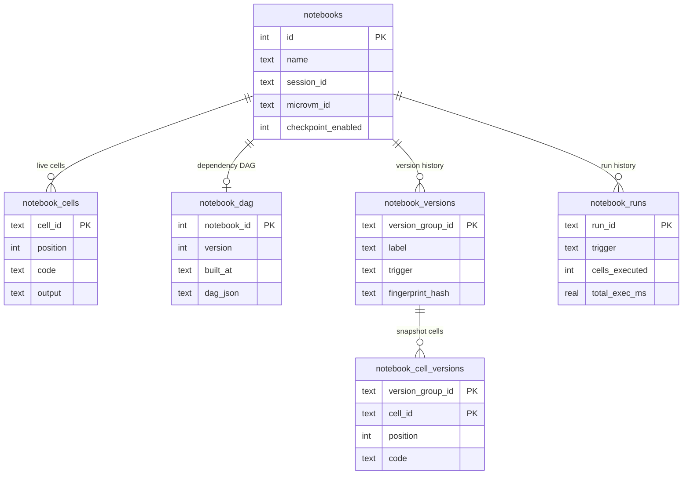
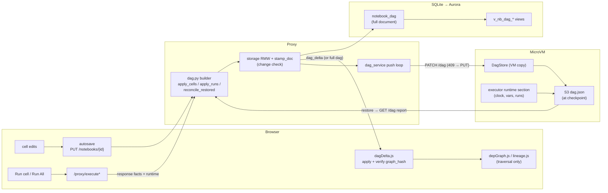
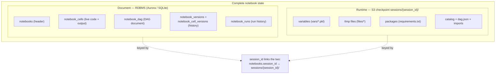
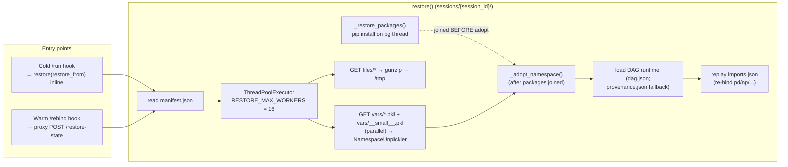
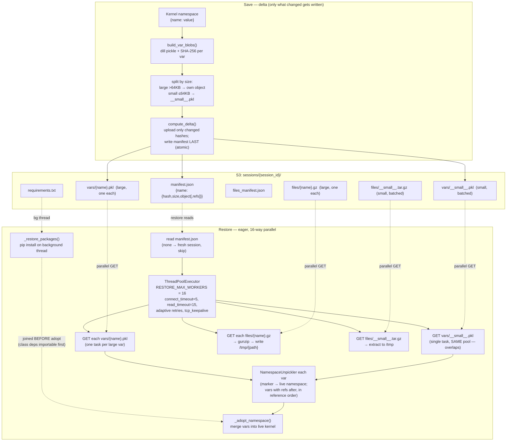
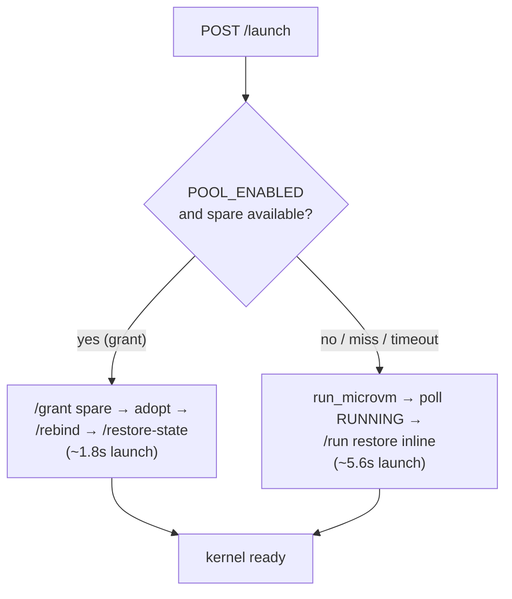

# Notebook state: what it is, and how it is saved and restored

This document is for people who need to know exactly what survives when a
MicroVM goes idle, is terminated or is replaced, and where each piece lives. The
[README](README.md) gives the overview, [SETUP.md](SETUP.md) lists the settings,
and this page holds the detail. It reads in this order:

1. The two stores and the persistence modes (this section and the next).
2. Part 1: the runtime state saved to S3, and which lifecycle hook saves it.
3. Part 2: the notebook document in the database, including the dependency DAG.
4. Part 3: how the two halves fit together.
5. Part 4: restore, startup paths and the delta mechanics.

A notebook's complete state lives in **two stores**, and it takes both to
reconstruct a session:

1. **The S3 session checkpoint** — the kernel's *runtime* state: Python
   variables, `/tmp` data files, installed packages, import bindings, discovered
   data-catalog schemas, and a copy of the notebook's dependency DAG with its
   runtime section (variable provenance + run ledger) in `dag.json`. This is
   written by the MicroVM lifecycle hooks (primarily `/suspend`).
2. **The relational database** — the notebook *document*: the cells (code +
   structure + last-run fields), their version history, run history, and ONE
   dependency-DAG document per notebook (`notebook_dag`). The proxy's **SQLite**
   file is the source of truth; in AWS a sync worker replicates it to **Amazon Aurora
   PostgreSQL** (same schema, same `StorageBackend` interface).

Neither half alone is a complete notebook. The database holds *what the code is*;
the S3 checkpoint holds *what the kernel had computed*. Environment variables and
Secrets Manager references are a third, small piece: they live in the database
(`notebook_env`) and are injected again whenever a VM starts for the notebook.

## Persistence modes

`SESSION_PERSISTENCE_MODE` (default `checkpoint`, set in `scripts/config.sh`)
decides whether the runtime state is saved and who starts the replacement VM. An
unrecognized value is treated as `none`, so a typo fails safe to ephemeral.

| Mode | Saved to S3 on `/suspend` and `/terminate` | When the VM is gone |
|---|---|---|
| `checkpoint` (default) | Yes, only when the state changed | The state stays in S3. The user connects again from the notebook and restores it into a **new** VM. |
| `eternal` | Yes, only when the state changed | The next proxied request finds the VM dead and the proxy recovers on that request: launch a VM, restore from S3, relink the session, replay the request. |
| `none` | Never | The session state is lost. A restore request on launch is ignored. |

The save hooks are the same in `checkpoint` and `eternal`. The modes differ only in when a
new VM is started and linked. There is no rotation timer in either mode.

### Eternal recovery

Recovery is reactive and needs no scheduler, so it works behind a stateless or
horizontally scaled proxy.

1. A request finds the session's VM dead (AWS state `TERMINATED`, `TERMINATING`,
   `FAILED` or `NOT_FOUND`, or the forward failed). One recovery runs per session.
   Requests that arrive during recovery are queued and replayed in arrival order.
2. The proxy launches a replacement on the same architecture and memory tier. It
   takes a warm-pool spare when `POOL_ENABLED` is true and one is available,
   otherwise it cold-launches.
3. **Environment variables and secrets are injected again.** The proxy builds them
   with the same helper `/launch` uses (`build_user_env`): the notebook's persisted
   `notebook_env` row is merged under any values in the request, and the platform
   variables go under both. Secrets are references (ARNs); the VM's `/run` or
   `/rebind` hook resolves them from AWS Secrets Manager under its own execution
   role. If the session is not linked to a notebook, recovery starts the VM with the platform
   environment only and logs a warning.
4. The proxy waits for the VM to become healthy, then restores from S3. The restore
   retries up to 3 times with a 2 s then 4 s backoff.
5. Only after a successful restore does the proxy relink the session to the new VM.
   If the restore fails, it terminates the new VM and leaves the S3 checkpoint
   untouched (fail closed), so it never registers an empty VM over good state.

A cold recovery takes about 9 to 12 seconds, dominated by VM boot. Per-phase timings
are available at `GET /recovery-timings` on the proxy. After a confirmed death in `eternal` mode the proxy
also remembers the dead VM for 90 seconds, so a request that arrives after the
session mapping was dropped still triggers recovery.

Env var values are stored sealed (AES-256-GCM, key held by the proxy only) and
secrets are stored as references, never as values (`proxy/platform/env_crypto.py`,
the `notebook_env` table). See [SECURITY.md](SECURITY.md).

Grounded in:
- `app/platform/checkpoint/manager.py` — `save()`, `restore()`, delta helpers.
- `app/platform/checkpoint/delta.py` — per-var/per-file hashing + delta.
- `app/platform/checkpoint/namespace_filter.py` — which variables are saved and which are dropped on restore.
- `app/platform/hooks.py` — `/run`, `/rebind`, `/suspend`, `/terminate`, `/restore-state` hooks.
- `proxy/storage/sqlite_db.py` / `postgres_db.py` — the notebook document schema.
- `proxy/storage/_timestamps.py` — the shared timestamp format of both backends.
- `proxy/notebook/session_checkpoints.py` — S3 cleanup when a notebook is deleted.
- `proxy/platform/routes/microvm.py` — `/launch` (pool-grant vs cold-launch), `/terminate`.
- `proxy/platform/microvm_manager.py` — `build_user_env`, eternal-mode recovery.
- `proxy/notebook/dag.py` (builder), `proxy/notebook/dag_service.py` (capture,
  VM push/attach), `proxy/storage/_dag_doc.py` (stamping / change check),
  `app/notebook/dag_contract.py` (hashes + delta, shared by proxy and VM),
  `app/notebook/dag_store.py` (the VM's copy, `GET/PUT/PATCH /dag`).
- `web/src/services/dagDelta.js`, `depGraph.js`, `lineage.js`,
  `web/src/hooks/useNotebookCells.js`, `useTabsPersistence.js` — the browser side.

---

## Part 1 — Runtime state saved to S3, and on which hook

### When the save fires

The kernel's runtime state is checkpointed to S3 by the MicroVM lifecycle hooks.
There are two trigger points, and **`/suspend` is the primary one**:

- **`/suspend`** (going idle) — the last reliable save point. A VM that is killed
  while *suspended* never fires `/terminate`, so if we didn't save here, an
  abandoned notebook's state would be lost silently. The save is **awaited to
  completion** before the hook returns 200, because the platform freezes memory +
  disk the instant it returns — a fire-and-forget save would be frozen mid-upload.
- **`/terminate`** (shutting down while RUNNING) — the explicit-close / rotation
  path. Only fires when the VM is RUNNING at kill time.

Both are gated by a **dirty flag** (`CheckpointManager.is_dirty()`): if nothing
changed since the last checkpoint, the save is skipped entirely. The fingerprint
is the executor's provenance clock (it advances on every variable create, modify
or delete and on SQL writes), the sorted list of user-installed packages, and the
signatures of the `/tmp` data files, so a file-only change or a file deletion also
counts. The check can over-report (a cell that only read a variable still bumps the
clock), which costs one extra save and never loses state. Both hooks save in
`checkpoint` and `eternal` mode only, and only when the session has a session id. In `none` mode
checkpointing is off. A save failure is logged and does not fail the hook.

| Hook | When it fires | What it does |
|---|---|---|
| `/run` | A VM starts from the image | Resets the snapshot's frozen boto3 credentials, applies the session identity, injects env vars and secrets, and, when the payload names `restore_from`, restores from S3 inline (cold launch). |
| `/rebind` | A warm-pool spare is granted to a session | Resets credentials, applies the identity, env vars and secrets, and pre-warms the S3 connection. The proxy then calls `POST /restore-state` to restore. |
| `/suspend` | The VM goes idle | Saves if dirty. Awaited to completion. |
| `/resume` | Traffic arrives for a suspended VM | Resets credentials. Memory and disk come back from the suspend snapshot, so there is no S3 restore. |
| `/terminate` | Shutdown while the VM is RUNNING | Saves if dirty. Not fired for a VM that is SUSPENDED when it is reclaimed. |

The on-demand `POST /checkpoint-save` and `POST /restore-state` calls run under the
same execute lock as cells, so they never overlap a running cell. If the lock is not
free within 25 s (`CHECKPOINT_LOCK_WAIT_SECONDS`), they return a "busy" failure
instead of waiting.

**A failed save before a user terminate keeps the VM running.** "Terminate & Save"
and the MicroVMs panel's Terminate call the proxy's `POST /terminate`, which first
asks the VM for `POST /checkpoint-save`. When that save fails, the proxy does not
terminate the VM. It answers `409` with `{"error": "Save failed: <reason>. The VM was
kept running so you can free memory or save again.", "saveFailed": true, "reason",
"notSaved"}`, and the UI shows that message with two choices: **Keep running** or
**Terminate without saving** (body `{"terminateWithoutSaving": true}`, which skips
the save). A save counts as failed when the VM reports an error or "busy", when it
does not answer while the VM is still up, or when a variable was left out because it
would not fit in memory or on disk. A variable that cannot be pickled at all (an open
connection, for example) is left out as before and does not block the terminate. If
the VM itself stops during the save (the Lambda MicroVM endpoint answers an empty
`502` with `x-aws-proxy-error: APP_CONNECT_FAILED`, then the VM reports `TERMINATED`),
there is nothing left to keep: the proxy cleans up and the `200` body carries
`"checkpoint": {"success": false, "vmLost": true, "error"}`, which the UI shows. Deleting
a notebook sends `terminateWithoutSaving` (it checkpoints just before). The idle
`/suspend` save is time-bounded and never fails the hook; see
[Suspend save budget](#suspend-save-budget).

#### Suspend save budget
The platform runs the `/suspend` hook after the idle timeout and **terminates the VM,
losing its memory, when the hook times out or fails** ("Suspend lifecycle hook timed
out." / "... failed."). The image sets `suspendTimeoutInSeconds: 60` in the `--hooks`
JSON of `scripts/build_all_images.sh` (the service maximum; it was 10 s, and a save
that had to upload a changed 1.36 GB object ended the VM at 10.7 s). Resume stays
10 s, run and terminate 60 s.
- The hook gives the save `SUSPEND_SAVE_BUDGET_SECONDS = 45` s, then waits at most
  `SUSPEND_SAVE_ABORT_GRACE_SECONDS = 5` s more (`app/platform/hooks.py`). Env vars of
  the same names, read at each suspend (so `/proxy/set-env` works on a running VM),
  can only lower them. `tests/build/test_hook_timeouts.py` keeps the budget at least
  10 s below the hook timeout and budget + grace below it.
- Cancellation is cooperative (`app/platform/checkpoint/deadline.py`): the save
  thread checks the deadline before each variable, between 16 MiB spool-write
  slices, before every object and multipart part upload, before the small batch and
  the manifest, before each file upload and the files manifest, and before the tail
  and `metadata.json`. A large spooled pickle uses an explicit multipart upload
  (16 MiB parts, 8 in flight) that is aborted on a cancel or any error, and the spool
  files are deleted.
- Commit rule: `manifest.json` is written only when the deadline has not passed at
  the commit point (just before the small batch, which shares a key with the
  committed manifest, so the manifest always follows it). A stopped save leaves the
  previous checkpoint as the committed one. If the budget runs out after the var
  manifest was committed, that manifest is complete and the files manifest, tail
  JSON and `metadata.json` are skipped.
- The hook **always returns 200**. On a timeout, a variable left out for memory or
  disk, or any exception (including `MemoryError`), it logs a WARNING
  (`⚠️ SUSPEND SAVE <status> after <s>s (budget 45s): <reason>; not saved: ...`), keeps
  the dirty flag set so the next save retries, and lets the VM suspend with its
  memory intact. If the save thread is stuck inside one blocking call when the hook
  stops waiting, it aborts at its next check once the VM resumes; a lock keeps it from
  overlapping the next save.
- The outcome is `CheckpointManager.last_suspend_save` =
  `{status: ok | skipped | timed_out | failed, reason, duration_s, bytes, saved_at,
  budget_s, committed}`. `GET /vm-status` returns it as `last_suspend_save`, the proxy
  VM detail as `checkpoint.last_suspend_save`, and the Live MicroVMs card shows a
  "Last suspend save" row when it is not `ok`. The proxy only reads it from a RUNNING
  VM, so it appears after the next resume.
- `/terminate` and `/checkpoint-save` have no deadline (unchanged).

### What each piece of runtime state is, and where it lands in S3

`save()` writes to `sessions/{session_id}/` in a fixed step order. Each step
persists a distinct *kind* of runtime state:

| # | State | What it is | S3 object(s) |
|---|---|---|---|
| 1 | **Variables (namespace)** | Every picklable Python variable in the kernel — DataFrames, models, scalars. Not saved: dunder names, modules (re-bound from the import ledger, step 7), open file handles, locks, thread pools and boto3 clients, matplotlib and PIL display objects, and the names the executor injects itself (the `display()` function and the helper functions). | `manifest.json` + `vars/{name}.pkl` (large, >64 KB) + `vars/__small__.pkl` (small vars batched) |
| 2 | **`/tmp` data files** | Uploaded datasets and model artifacts under `/tmp` — the same set the Data Sources panel shows (data files recursive under `/tmp`, models at `/tmp` and `/tmp/models/`). | `files_manifest.json` + `files/{name}.gz` (large) + `files/__small__.tar.gz` (small batched) |
| 3 | **Installed packages** | The list of packages the user `pip install`ed at runtime, so they're reinstalled before the namespace is adopted. | `requirements.txt` |
| 4 | **Metadata** | Session info + per-step save timings/sizes (for diagnosis). | `metadata.json` |
| 5 | **Data catalog** | Discovered schemas for cloud sources (S3/Athena/DynamoDB/Bedrock KB) + local files, so a new VM doesn't re-run discovery. | `data_catalog.json` |
| 6 | **Notebook DAG copy** | The VM's copy of the notebook's dependency document (nodes, edges, issues — the last one the proxy pushed, or empty doc fields), plus the executor's `runtime` section snapshotted at the very start of `save()` (per-variable provenance — which cell created/modified each *user* variable, `last_exec` clock — and the per-cell run ledger), plus a `checkpoint` stamp `{id, saved_at, session_id, microvm_id}` whose `id` is also written to `manifest.json`. "Defined in", staleness and the run ledger survive a restore. | `dag.json` (replaces `provenance.json`, which is never written and only read as a fallback for old checkpoints) |
| 7 | **Import ledger** | `binding-name → import line` (e.g. `pd → import pandas as pd`). Modules can't be pickled, so these are replayed on restore to re-bind `pd`/`np`/etc. | `imports.json` |

### How the save stays cheap — content-addressed delta

Variables and files are saved as a **delta**: each var is pickled and hashed
(SHA-256), each file is signatured by `(size, mtime_ns)`, and only objects whose
hash/signature changed since the last save are re-uploaded. Objects ≤64 KB are
batched into a single object (`__small__.pkl` / `__small__.tar.gz`) to avoid a
PUT-per-tiny-item explosion. The manifest is written **last** (an atomic swap) so
a restore only ever trusts a manifest that points at fully-uploaded objects.

- `delta.py` → `build_var_blobs()` (marker-aware dill pickler + SHA-256 per var), `file_signature()`,
  `DELTA_SMALL_VAR_BYTES` / `DELTA_SMALL_FILE_BYTES` = 65536.
- `manager.py` → `_save_namespace_delta()`, `_save_files_delta()`.

**Large variables are streamed to disk, not built in memory.** Each variable is
pickled with the checkpoint pickler (`nspickle.NamespacePickler`, a `dill.Pickler`,
protocol 5; see below) into a sink that hashes as it writes and keeps
only the first 64 KB in memory. A larger pickle goes to a file under
`/tmp/.checkpoint-spool/` (`CHECKPOINT_SPOOL_DIR`; `/tmp` is on disk in the VM, and
the hidden directory and `.part` suffix keep it out of the `/tmp` file checkpoint).
The file is uploaded with the managed S3 multipart upload and deleted after the
save. dill's pure-Python pickler still copies one numpy or pandas buffer while it
writes it, so a save needs the live value plus about 1x its data size (measured
1.0x with tracemalloc). Before, `dill.dumps` needed 2x on top of the live value (the
buffer copy and the `BytesIO` result), and on the 1 GB tier a single array of more
than about 1.1 GiB pushed the notebook server into the out-of-memory killer (exit
code 137) with nothing saved.

**A variable that would not fit is skipped, not fatal.** Before pickling a large
variable, the save estimates its size (numpy `nbytes`, pandas `memory_usage`, sums
for containers) and checks it against `MemAvailable` minus 256 MiB and the free
space of the spool directory minus 64 MiB. A variable that does not fit, or whose
pickling raises `MemoryError` or fills the disk, is left out with a reason such as
"not enough memory to save 'big' (needs about 1300 MiB, 900 MiB available)", and
everything else is saved. The left-out variables are listed in `manifest.json`
(`not_saved`), `metadata.json` (`not_saved`), the `/checkpoint-save` response and
`/vm-status`, and the MicroVMs card shows them on a "Not saved" row. If a variable
left out for memory or disk had been saved before, the new manifest keeps its previous
entry and object (`"kept_previous": true` in `not_saved`), so a restore brings back that
older value and neither "Terminate without saving" nor an idle suspend loses it. A
variable that was never saved, or that cannot be pickled at all, is not restored.

**A failed save never damages the previous checkpoint.** A changed large variable is
uploaded to whichever of `vars/{name}.pkl` and `vars/{name}.alt.pkl` the committed
manifest does not reference. The small batch is written after every large object,
then `manifest.json`, and only after the manifest is committed are the objects it no
longer references deleted. If an upload fails, the old manifest and its objects stay
as they were. One narrow case remains: the small batch keeps its fixed key (older
images read only that key), so a failure between its PUT and the manifest PUT can
leave the newer small values under the old manifest.

**Functions keep a reference to the live namespace, not a copy of it.** A function,
lambda, method or class defined in a cell has the notebook namespace dict as its
`__globals__`. Plain dill pickles such a function together with a copy of that dict,
so every function carried every variable: a 2-line helper next to a 1.3 GB array was
a 1,363,157,457-byte `vars/<fn>.pkl`, and after a restore its globals were a detached
copy that no longer saw the live variables. The checkpoint pickler
(`app/platform/checkpoint/nspickle.py`) writes the executor namespace dict, matched by
identity at any depth, as the persistent id `"notebook-namespace"` (`persistent_id`),
and replaces dill's `FunctionType` entry so a namespace-bound function is saved with
its code, defaults, closure and attributes and the namespace as that marker. At
restore `NamespaceUnpickler.persistent_load` binds the marker to the live
`executor._namespace` (the dict the values are then adopted into), so restored
functions, methods and classes see the current value of every global, including
imports replayed after the variables load. The same helper next to a 50 MiB array now
pickles to about 250 bytes and goes into the small batch. Everything that is not a
namespace-bound function pickles to the same bytes as `dill.dump`, so data hashes did
not change (function hashes changed once). Rules and limits:
- Every load of a var pickle must go through `NamespaceUnpickler`; a plain
  `dill.loads` of a pickle that holds the marker raises `UnpicklingError`, and so does
  any other persistent id. Model exports (`save_model`) are unchanged and marker-free.
- Values are pickled one variable at a time. Sharing within one variable is kept by
  pickle's memo; sharing across variables (classes, functions, data aliases such as
  `b = a`, and closure cells) is kept by the by-name references in the next two
  paragraphs.
- A checkpoint from before this change needs no special handling: a function with
  embedded globals still loads (with detached globals), and a value that will not load
  is skipped, reported as `{name, reason}` in `last_restore_not_restored` and in the
  restore report as `vars_not_restored`, and the rest of the restore continues.

**Classes and functions are referenced by name, so restored instances keep their
class.** Pickled on its own, every variable that used a class defined in a cell
carried its own copy of that class: after a restore `type(c) is C` and
`isinstance(c, C)` were False, a class counter (`C.count += 1`) was a separate copy
per variable, and an instance of a class with a 2 MB class attribute pickled to 2 MB.
At save time `build_var_blobs` builds a map (`nspickle.build_ref_map`) of every
top-level variable whose value is a class defined in the notebook (not importable from
a module; an importable class already pickles by reference) or a function bound to the
namespace. Each one has a canonical name: the variable named like its `__name__`, else
the first in sorted order. The canonical variable pickles the class or function by
value, as before (methods carry the namespace marker). Anywhere else in any variable's
object graph (an instance's class, a base class, a metaclass, a class attribute, a
function default, a dict value, an Enum member), the pickler writes the persistent id
`("mvm-ns-class", name)` or `("mvm-ns-function", name)` instead. An alias (`D = C`)
pickles as just the reference, so it restores as the same object (`D is C`). The
instance `c` above is now 85 bytes. The reference is a memoized reduce around the
persistent id, so a list of 10,000 instances writes it once (50,102 bytes, against
50,255 with the class copied in). Rules and limits:
- **Manifest.** A variable that holds references gets `"refs": [names]` in
  `manifest.json` (for example `c → ["C"]`, `D → ["C"]`, `C → ["Base"]`).
- **Restore order.** Variables without refs load in the download pool as before. Those
  with refs are unpickled after every download, in reference order: a base class
  before its subclasses, a class before its instances and before functions whose
  defaults hold it. `persistent_load` resolves a reference to the value restored under
  that name, and loads that variable on demand when it is still pending, so a missing
  or out-of-order `refs` list cannot bind a wrong object. A reference to a variable
  that was not restored fails only the variable that holds it, reported as
  `references class 'C', which was not restored` in `vars_not_restored`. Any other
  persistent id, or a reference to a name bound to something that is not a class or
  function, raises `UnpicklingError`.
- **Class state is shared.** `C.count`, a registry list on the class and
  `c.count is C.count` behave as before the save, and new instances update them.
- **Redefining a class.** Re-running a class cell creates a new class object. Live
  Python keeps existing instances on the old class. The save references the old class
  by name when that name now holds a notebook class with the same `__qualname__` and
  `__module__`, so the class variable is uploaded again but the instance variables keep
  their bytes and hash, and after a restore the instances (and subclasses) use the
  current definition. This matches how unpickling an instance of a module class binds
  to the module's current class.
- **Still by value.** A class defined inside a function (no top-level name), a class
  deleted from the namespace after its instances were made, and an object of a class
  that is importable from a module are pickled as before.
- **Not saved.** A class or function variable that cannot be pickled (an unpicklable
  class attribute) is reported as not saved, and the variables that referenced it are
  pickled again with it by value (usually not saved for the same reason).
- **Cycles.** Two variables that reference each other (`fa.peer = fb` and
  `def fb(other=fa)`) cannot both load the other first. The save breaks the cycle: the
  variable that loads first embeds the other by value (`"by_value": ["fb"]` in its
  manifest entry; the restore report lists it as `refs_by_value`, and that copy is not
  the restored `fb`). dill cannot pickle a class by value inside such a cycle (two
  classes whose class attributes reference each other, or a class attribute and a
  function default), so those variables and their instances are reported as not
  saved, as they were before by-name references.
- **Enums.** dill cannot pickle an Enum class defined in a cell (its members are
  instances of the class), so before this change a notebook Enum and every variable
  holding a member were not saved. The checkpoint pickler saves an Enum class as its
  metaclass, bases, body and member values and creates it again through the metaclass
  on load. Members restore as the class's singletons (`color is Color.RED`). An Enum
  whose `__new__` or `__init__` sets `_value_` to something other than the value
  written in the class body does not restore (its members are rebuilt from `_value_`).
- **Hashes.** The class variable still hashes by its own definition. An instance
  variable's bytes hold the reference instead of a class copy, so it changes only when
  its own data changes. Before the first pickle, `build_ref_map` fills each class's
  `__slotnames__` cache (pickling an instance fills it anyway), so a class pickles to
  the same bytes on the first and every later save.

**Data aliases and shared closure cells are referenced by name too.** Before, every
alias between two top-level variables was lost: `b = a` restored as two lists, a dict
held inside another dict restored as a copy, a DataFrame bound under 4 names was
uploaded and restored 4 times, and `inc, get = make_counter()` gave each function its
own copy of the shared `nonlocal` cell, so after a restore `get()` no longer saw
`inc()`'s updates (no error, just a wrong result).
- **Values.** `build_ref_map` also maps every top-level value that `nspickle.aliasable`
  accepts: an exact `list`, `dict`, `set`, `bytearray` or `collections` container, a
  numpy array, a pandas DataFrame, Series or Index, or an instance of a class defined
  in the notebook (not an Enum member). The canonical variable pickles the value;
  anywhere else it is `("mvm-ns-value", name)`, with the referenced name in `refs`.
  `b = a` is then an 82-byte reference, and after a restore `b is a`.
- **Library objects stay by value.** A top-level name bound to a library object (a
  numpy dtype, a logger, `pd.NaT`, a library's dict subclass) is never in the map, so
  binding one does not make every array that shares the dtype reference that name.
- **Canonical name.** The name that held the value by value in the previous manifest
  keeps it while it is still bound (sticky), else the first in sorted order. Adding
  (`aaa = df`) or deleting an alias uploads only the small reference.
- **Closure cells.** Each closure cell of a top-level function is owned by the first
  function, by name, that holds it. Another function that shares the cell writes
  `("mvm-ns-cell", "owner#i")`, which the restore resolves to
  `owner.__closure__[i]`, so `inc.__closure__[0] is get.__closure__[0]` again. The
  reference counts as a reference to the owner in `refs`.
- **Failures.** A referrer has no copy of its own: when the owner fails to unpickle,
  every variable that references it is listed in `vars_not_restored` as well (for
  example `references function 'get', which was not restored`). An owner that is not
  saved is dropped from the map, and its referrers are pickled again with their own
  copy, as before.
- **Restore adopts values as unpickled.** The restore used to `deepcopy` every
  top-level list, dict and set, one variable at a time, which split the aliases again,
  raised the restore peak (80 MB for a 64 MB restore) and made the first save after a
  restore re-upload unchanged dicts holding DataFrames. It is gone; live runtime
  objects (locks, pools, futures, boto3 clients) are still dropped.
- **Limits.** A numpy view or a DataFrame column (another object that shares a buffer)
  is not covered and restores as a copy. A cycle between two variables (`a = []`,
  `b = [a]`, `a.append(b)`) keeps identity on one side only; the other side's copy is
  listed in `refs_by_value`. Immutable values (ints, strings, tuples) are not mapped.

**The injected `display()` is never checkpointed.** The executor binds a fresh
`display()` function into the namespace on every run. Its closure refers to the
executor, so pickling it would drag a copy of the old executor into the checkpoint.
`namespace_filter.py` recognises the shim and the helper functions by identity, so a
user's own `display = 5` or `def display(...)` is still saved. On restore, a
checkpoint written by an older image that still lists an injected name never
replaces the live object. Nothing is deleted from S3, and the next save
simply stops listing it.

**One bad variable does not fail the save or the restore.** The small variables are
stored as a batch of already-pickled bytes (`vars/__small__.pkl`, format 2), so
loading the batch runs no user code and each variable is unpickled on its own. A
variable that pickled but will not unpickle is skipped on restore with a warning that
names it and the error type, never the value. Checkpoints that used the older
format 1 batch still restore. A missing S3 object is different: it
means the checkpoint is broken, and the restore fails.

---

## Part 2 — The notebook document in the relational database

The S3 checkpoint is runtime state. The **notebook itself** — the code, its
dependency DAG and its history — lives in a relational database: the proxy's
**SQLite** file (the source of truth), replicated to **Amazon Aurora PostgreSQL** in AWS;
same schema in both (`proxy/storage/sqlite_db.py` and `postgres_db.py` behind one
`StorageBackend` interface, `proxy/storage/interface.py`).

This is deliberately separate from the checkpoint. From `interface.py`:

> `notebook_cells` : the live working copy (overwritten by autosave).
> `notebook_runs` : execution-event summaries (timings/status).
> the S3/VM checkpoint: kernel RUNTIME state (namespace/packages), **not code**.

### The document tables

| Table | What it holds | Key columns |
|---|---|---|
| `notebooks` | One row per notebook (header). | `id`, `name`, `session_id`, `microvm_id`, `checkpoint_enabled` |
| `notebook_cells` | The **live** working copy — one row per cell. Code + latest output + the last run's fields. No dependency facts (no `vars_*` / sources columns) — those live in `notebook_dag`. A chart is stored as an S3 key, never as image bytes. | `cell_id`, `position`, `type`, `code`, `output` / `error` / `html`, `output_variable`, `image_s3_key` (a key under `notebook-outputs/<notebook_id>/`); run fields `execution_number`, `execution_time`, `last_executed_code`, `peak_mem_mb`, `peak_cpu_pct`, `executed_at`; `updated_at` (sync watermark) |
| `notebook_env` | One row per notebook: its environment variables and Secrets Manager references. Env var values are sealed (AES-256-GCM); secrets are ARN references only. Read when a VM is launched or recovered. | `notebook_id`, `env_json`, `updated_at` |
| `notebook_dag` | One row per notebook: the **DAG document** (one JSON document) built by the proxy from the cells' code and the captured runs. | `notebook_id`, `version`, `built_at`, `dag_json`, `updated_at` (sync watermark) |
| `notebook_versions` | **Version history header** — a point-in-time snapshot group of the cell *document*. Append-only, created at deliberate checkpoints (manual save, auto-interval, before an AI edit). | `version_group_id`, `label`, `trigger`, `fingerprint_hash` |
| `notebook_cell_versions` | The lean per-cell snapshot rows for a version group. **Document-only** — omits runtime output (regenerated on re-run). | `version_group_id`, `cell_id`, `position`, `code` |
| `notebook_runs` | Write-only execution history — one row per run (single / Run All / run-from). | `run_id`, `trigger`, `cells_executed`, `total_exec_ms`, `run_cells_json` |

### Live copy vs. versions

- `notebook_cells` is the **working copy**, overwritten by autosave on every edit.
- A **version** is only cut at deliberate moments (`trigger` = `manual` / `auto` /
  `pre_ai` / `pre_restore`). Each version is a header (`notebook_versions`) plus a
  set of lean document-only snapshot rows (`notebook_cell_versions`), grouped by
  `version_group_id`. `fingerprint_hash` dedups identical non-manual snapshots so
  an unchanged auto-version isn't stored twice.
- Versions snapshot the **document only** (code, type, position, output_variable,
  ai_explanation, generated) — not runtime output, which regenerates on re-run.

### Local vs. AWS, and durability

In the local demo everything is in **SQLite**. In AWS the same rows live in
**Amazon Aurora PostgreSQL**; a background sync worker (`sync/sync_to_aurora.py`)
replicates SQLite → Aurora by each table's `updated_at` watermark, so the
document is durable and shareable across devices even though the proxy keeps
SQLite as its fast local source of truth. `notebook_dag` is synced the same way
(a runtime-only DAG write still bumps `updated_at`, so it replicates too). The
schema and the `StorageBackend` interface are identical, so the notebook
document behaves the same either way; a schema change goes into both backends
through `interface.py` (no migration framework).

**Where the SQLite file lives.** The default is `proxy/data/microvm.db`. Set
`STORAGE_DB_PATH` to use another file; the data directory then follows that file's
directory. `STORAGE_BACKEND` selects SQLite or Postgres. The standalone pool manager
creates only the tables it uses (`vm_sessions`, `session_registry`, `pool_vms` and
the pick index) when it starts, with `CREATE ... IF NOT EXISTS`, so it never drops
or alters a table and needs no proxy start first.

#### SQLite and Postgres behave the same

The two backends are meant to return the same data for the same calls. These rules
keep them aligned. `tests/storage/test_storage_conformance.py` runs the same checks
against each backend:

- **Timestamps** are ISO-8601 UTC strings (`YYYY-MM-DDTHH:MM:SS[.ffffff]+00:00`) or
  `None` from either backend (`proxy/storage/_timestamps.py::iso_utc`). SQLite
  stores three text shapes and Postgres returns `timestamptz` values; both are
  normalised on read, and an unparseable value is stored as `NULL` instead of
  breaking a later timestamp cast. The Postgres connection pins the session
  `TimeZone` to UTC.
- **Ordering of missing values:** run history sorts `ORDER BY finished_at DESC NULLS LAST`
  in both, so runs without a finish time come last.
- **Paging bounds:** where a call takes `limit` and `offset` (agent message paging),
  a negative value is treated as 0 in both. A missing `limit` means no limit.
- **Re-registering a row:** both use `INSERT ... ON CONFLICT DO UPDATE`, never
  `INSERT OR REPLACE`, so the row is updated in place and the sync worker sees a newer
  `updated_at`. Registering an existing `microvm_id` (`vm_session_create`) keeps
  `burst_mb_seconds`, `image_arn` and `created_at`, clears `terminated_at` because the VM is
  RUNNING again, and takes every other column from the new launch. Re-using a `run_id`
  (`notebook_run_create`) keeps the original `created_at` and takes every other
  column from the new call.

#### Deleting a notebook

`DELETE /notebooks/{id}` removes the database rows (cells, DAG, versions, runs,
env; child tables cascade). After the delete commits it removes the notebook's S3
data, best-effort: a cleanup failure never fails the delete. The removed prefixes are:

| S3 prefix | What it holds |
|---|---|
| `sessions/<session_id>/` | Checkpoints of every session the notebook owned |
| `attachments/<session_id>/` | Chat attachments |
| `user-data/<session_id>/` | Attachments promoted to a session data source (`DATASOURCE_S3_SESSION_PREFIX`) |
| `attachments/<notebook_id>/` | Chat attachments of a tab that had no session id yet |
| `notebook-outputs/<notebook_id>/` | Chart images of the notebook's cells |

A session counts as owned only when no other surviving notebook references it. The
ids are validated first (a session id must match `SESSION_ID_RE`, a notebook id must
be a positive integer), so an empty or wildcard id cannot form a broader prefix.
`user-data/<notebook_id>/` is deliberately **not** deleted because a short numeric
folder there may be a user's own shared folder. Nothing outside these prefixes is touched (not
`samples/`, `knowledge-base/`, `models/`, `sagemaker/`, `unload/`, or the shared
flat `user-data/` files). `local_stop_app.sh delete-notebooks` uses the same cleanup.

### The cell dependency graph — one stored DAG document per notebook

A notebook is not just an ordered list of cells; it's a **dependency graph** —
which cell defines a variable, which cells read or mutate it, and which cell last
touched it. All of it lives in **one JSON document per notebook** (`schema: 1`),
stored in `notebook_dag.dag_json` through the `StorageBackend` interface (SQLite
and Amazon Aurora PostgreSQL alike) and copied to the VM and into every runtime
checkpoint as `dag.json`.

#### What the document holds

- **Nodes** — one per code/SQL cell (markdown cells have none): `position`,
  `cell_type`, `code_hash`, SQL `output_variable`; the facts `reads` / `writes` /
  `mutates` / `dynamic` and captured `sources` with `facts_origin` (`static` from
  the code, `runtime` from the executor's observed run); the run bookkeeping
  `run_hash` (the code that last ran), `last_run_ok`, `not_in_checkpoint`, the run
  clocks `executed_at` / `last_run_seq` / `last_ok_seq`; and the derived `level`,
  `status` (`current` / `stale` / `edited` / `never_run` / `error`) and
  `stale_reason` (`upstream_changed`, `upstream_stale`, `not_in_checkpoint`).
- **Edges** — `{from, to, var, kind: defines|mutates, use: read|mutate, origin,
  backward}`.
- **Issues** — `{cell_id, code, severity, var, related, source, detail}`; info:
  `cross_cell_mutation`, `multiple_definitions`, `external_state`; amber (they
  weaken lineage trust): `dynamic_names`, `missing_producer`, `out_of_order`,
  `cycle`.
- **`runtime`** — owned by the VM and copied verbatim from its execute
  responses: `clock` (the executor's monotonic `_prov_clock`), `vars` — per-variable
  provenance `{defined_by, defined_at, modified_by[], last_cell, last_exec}`, the
  former `provenance.json` — and `runs` (per-cell run ledger `{code_hash, clock,
  ok}`), plus the `vm_id` it came from. `vars` holds **user variables only**: the
  executor never records dunders (`__builtins__`), modules (`pd`, `np`, `os`) or
  sandbox-injected helpers / the `display()` shim still bound to the injected
  object — the same filter as each run's def-use lists — and drops such entries
  when it loads the runtime of an older checkpoint. (Modules are re-bound from
  `imports.json`, a separate ledger.)
- **`pending`** — captured runs of cells the proxy has not seen saved yet; adopted
  when the save arrives, dropped after 120 s.
- **Stamps** — `notebook_id`, `trigger`, `built_at`, `version`, `runtime_version`,
  `graph_hash`, `runtime_hash` (and, only in `dag.json`, `checkpoint`).

#### The builder

`proxy/notebook/dag.py` (pure: stdlib + `app/notebook/static_analysis.py` +
`dag_contract.py`) is the **only** place that infers dependencies:

- Static facts come from `static_analysis.analyze_cell` (the same module the VM
  executor uses): Python free names / assignment targets via `ast`, SQL `{var}`
  placeholders and bare `FROM`/`JOIN` identifiers. After a run the executor's
  observed facts (`variables_read`, `variables_created`, `variables_rebound`,
  `variables_mutated`, captured sources) replace them while the code hash still
  matches.
- **Edge rule:** each read resolves to the **nearest earlier producer in notebook
  order** (a node that writes or mutates the variable at a lower position). A cell
  that mutates a variable in place (`df['c'] = …`) is both a reader and a writer,
  so builder → mutator → reader chains are explicit: the reader's edge comes from
  the mutator. With no earlier producer the runtime owner (`runtime.vars[v].last_cell`)
  or the last producer is used, the edge is marked `backward` and an
  `out_of_order` issue is raised; with no producer at all (runtime facts only) it
  is `missing_producer`.
- `finalize` then computes levels (forward edges), cycles (Tarjan →
  `cycle`), statuses, stale reasons and the remaining issues deterministically.

#### When it is rebuilt

- **Open** (`GET /notebooks/{id}`, `GET /notebooks/{id}/dag`) — `get_or_build`
  rebuilds (`apply_cells`, trigger `open`) only when the stored document is missing
  or out of sync with the stored cells. Never contacts the VM.
- **Create / save / version restore** — `POST /notebooks`, `PUT /notebooks/{id}`
  (autosave) and version restore run `apply_cells` in the **same transaction** as
  the cell write (a DAG failure never fails the save).
- **Every execute, including batches** — `/proxy/execute`, `/execute-sql`,
  `/set-variable`, `/reset` responses are captured (`apply_runs` / `apply_runtime`)
  in one locked read-modify-write inside the request; a Run All / run-from /
  reactive batch (`/proxy/execute-batch`) is captured once, on the stream's
  `done`, as ONE write for the whole batch.

#### Change check and delta transport

- **Change check** (`proxy/storage/_dag_doc.py::stamp_doc`, contract in
  `app/notebook/dag_contract.py`): the document is partitioned into STAMP keys
  (never hashed), the RUNTIME channel (`runtime`, `pending`, `run_seq`, the node
  run clocks → `runtime_hash`) and the GRAPH (everything else → `graph_hash`;
  sha256 of canonical JSON). A graph change bumps `version` (and `built_at`); a
  runtime-only change keeps them and bumps `runtime_version`; when neither hash
  changed **nothing is written**. Revision = `(version, runtime_version)`,
  compared lexicographically everywhere. The DB row, the VM copy and `dag.json`
  always hold the **full** document — deltas are transport only.
- **To the browser:** `/proxy/execute*` responses carry exactly one of `dag_delta`
  (diff from the previous revision; a ~355 B "unchanged marker" when nothing was
  written), the full `dag` (first document, or a delta larger than half the full
  document — the size guard) or `dag_error`; the batch stream sends one
  `{type:"dag"}` frame before `done`. The notebook routes and
  `GET /notebooks/{id}/dag` always return the full document (the resync path).
  `dagDelta.js` applies a delta only when its base equals the local revision and
  the recomputed `graph_hash` matches (byte-identical to Python's); otherwise it
  does ONE single-flight `GET …/dag` before any reactive decision reads the
  document.
- **To the VM:** pushed only when the graph or the run clocks changed (the VM owns
  its runtime). The push loop **coalesces**: it diffs the document the VM last
  acknowledged against the CURRENT DB document and sends one cumulative
  `PATCH /dag`; `409` (no document / base mismatch / hash mismatch) → one full
  `PUT /dag`; an image without PATCH → PUTs. Both verbs carry the per-VM token
  plus `X-Dag-Writer: proxy`, and the browser-facing forward refuses `/proxy/dag`.
  The VM never keeps `runtime`, `pending` or `checkpoint` in its copy. Before a
  proxy-initiated checkpoint, `flush` brings the VM to the current DB document
  (at least a marker PATCH, so a VM that lost its copy gets a PUT).

#### The VM copy, `dag.json` and restore reconciliation

The runtime section reflects the order cells actually ran in this session — it
can't be re-derived from code — so every save writes `dag.json`: the VM copy +
the runtime section + the `checkpoint` stamp (its `id` is also in
`manifest.json`). `checkpoint` is a STAMP key, so it never changes `graph_hash`.

On restore the VM reads `dag.json` (falling back to an old `provenance.json`, then
to nothing). It loads the runtime section — the whole section when the stamp's id
matches `manifest.json` (`consistent`), otherwise vars + clock without the run
ledger — and keeps the document **without** the `checkpoint` stamp as its copy,
so the first `PATCH /dag` after a restore verifies. The stamp stays in the VM's
`GET /dag` report (`{origin, doc, runtime, restored_from, runtime_source,
consistent, checkpoint}`). When the proxy attaches to the VM it reconciles
(`reconcile_restored`): with a consistent `dag.json`, a node is in memory when its
run-ledger `code_hash` equals the node's `run_hash`; otherwise (no ledger entry,
inconsistent `dag.json`, `provenance.json`) when provenance shows the node touched
one of its writes; with no runtime at all only nodes that write nothing are in.
Nodes not in memory get `not_in_checkpoint` ("Not in the current session's memory
— re-run to update"). A cold launch without restore marks every node that ran and
writes something the same way.

#### What the browser computes vs the server

The server (proxy) infers everything: nodes, edges, levels, statuses, stale
reasons and issues. The browser only **traverses** the stored document
(`web/src/services/depGraph.js`, `lineage.js`): the "How was this computed?"
lineage drawer, trust dots, the dependency-notes badge, the Outline's stale
markers, "Defined in" in the Variables panel (`runtime.vars` overlaid on the
VM's `/variables` values) and reactive re-runs (downstream ∩ stale, gated on
`runtime.vars` clocks that advanced since the run started) all read the same
document, so they can never disagree. The one browser-side status rule: a live
cell whose code differs from `lastExecutedCode` shows as `edited` before the
autosave lands.

#### Autosave (`web/src/hooks/useTabsPersistence.js`)

- Every tab is cached in `localStorage` (1.5 s debounce; never the DAG, never the
  transient `_batchRunning` flag).
- `PUT /notebooks/{id}` (the save that also rebuilds the DAG) is debounced 3 s and
  re-armed by user-content edits (code, type, output variable, AI explanation,
  name/description/tag) and by **completed** single-cell runs (`executedAt`), so a
  run with no edits still persists its run fields (`executionNumber`,
  `executedAt`, `peakMemMb`, …). VM-binding churn and output streaming never
  schedule a save.
- **During a batch** (Run All / run-from / reactive cascade — `executeBatch`
  marks the tab `_batchRunning`) completed runs are **held**: ONE debounced save
  follows the batch end, plus a max-wait safety save at most every 30 s while
  completions keep arriving, so a crash mid-batch loses little. User edits during
  a batch still save on the normal 3 s debounce.
- A manual "Save version" first flushes the autosave synchronously
  (`flush-autosave`); auto-versions are a separate 5-minute interval, deduped by
  the server.

#### Querying it

Curated read-only views expand the JSON for SQL: `v_nb_dag_nodes`,
`v_nb_dag_edges`, `v_nb_dag_issues` and `v_nb_dag_lineage` (identical columns in
SQLite and Postgres; granted to the read-only Aurora role).

#### Not built yet (Phase 2)

Parallel SQL execution per `level`, skipping unneeded cells in App runs (only the
upstream closure of the shown outputs), and input-hash caching (skip a cell whose
code hash and inputs are unchanged) are deferred. So are pushing the DAG to a
RUNNING VM on save (code-only edits reach `dag.json` only via the next execute or
a proxy-initiated checkpoint's flush) and marking nodes after `/reset` as not in
memory.

In short — three cleanly separated layers, each stored where it belongs:

| Layer | What it is | Where it lives | Why there |
|---|---|---|---|
| **Code** | Cell source + structure + last-run fields | RDBMS (`notebook_cells`) | Authoritative, per-keystroke mutable, queried + versioned |
| **Dependency DAG** | Nodes, edges, issues, statuses (one document) | RDBMS (`notebook_dag`), rebuilt by the proxy on open/save/execute; copy on the VM | One builder, one copy every consumer reads; queryable through the `v_nb_dag_*` views |
| **Runtime section** | Provenance of user variables (owner + last-touch clock) + run ledger | Inside the DAG document, and in the S3 checkpoint (`dag.json`) | Runtime-only; can't be re-derived from static code, so it must survive a VM swap |

---

## Part 3 — The two halves together = complete notebook state

Put the two stores side by side and the full picture emerges. The database
reconstructs *the notebook you see and edit*; the S3 checkpoint reconstructs
*the kernel that was running underneath it*. Both are keyed so they line up: the
notebook row carries the `session_id`, and the checkpoint lives at
`sessions/{session_id}/`.

- Open a notebook and the **document** loads from the DB instantly — you see the
  code and last-saved outputs even if no VM is running.
- Connect to a sandbox and the **runtime** is restored from the S3 checkpoint into
  a **new** VM, so re-running a cell uses the same variables/files/packages as before.
  The Connect dialog offers two choices: restore the saved session into a new VM,
  or launch a new VM without restoring. There is no attach to an existing VM, and the
  dialog does not list existing VMs. `POST /terminate` from a
  session other than the VM's own returns `409` ("microvmId belongs to a different
  session") before any checkpoint or terminate, so one tab can't checkpoint over
  or kill another notebook's VM. When the pre-terminate save fails, `/terminate`
  returns `409` with `"saveFailed": true` and keeps the VM running (see "When the
  save fires").

---

## Part 4 — Restore: reconstructing the runtime into a VM

When a VM starts for a session, the document is already available from the DB;
the work left is to rebuild the **runtime** from the S3 checkpoint. There are two
entry points, both ending at the same place — `restore()` adopting the namespace
into the kernel:

- **Cold launch** — the `/run` hook calls `restore(restore_from)` inline.
- **Warm-pool grant** — a spare VM is already booted; the proxy `/rebind`s its
  identity, then issues a separate `/restore-state`.

On `/launch` with `restoreFromSession`, the **default** is a same-architecture,
same-tier restore, enforced by the proxy. It looks up the session's most recent VM and
overrides the requested architecture and memory tier with the saved ones (and reuses the
saved idle timeout and maximum lifetime unless the pool fixes them), so the client only
needs to know the session id. Auto-restore on cell execution and reactive recovery always
use this default. A saved architecture that is no longer offered is restored on an
offered one, because packages are reinstalled by name and the pickled namespace
is portable between arm64 and x86_64. In `none` mode the restore request is ignored.

**Explicit choice.** The user can restore onto a different architecture or memory tier
from the Connect dialog (Restore on a different instance type, collapsed by default, with
the saved values preselected and labeled saved). The client then sends
`restoreOverride: true` together with `arch` and `memoryMiB`, and only when either value
differs from the saved one. The proxy honors the pair only when `restoreOverride` is
exactly `true`; otherwise it pins the saved values. An arch outside `IMAGE_ARCHES` or a
memory size that is not a tier of that arch returns a `400` JSON error and nothing is
launched. The proxy records the effective arch and tier in the `vm_sessions` row, so the
next default restore uses the new values. No new stored field is needed.

| Choice | Result |
|---|---|
| Default (saved arch and tier) | Allowed, with a memory warning when the checkpoint is big for the saved tier. |
| Larger tier | Allowed, with a memory warning only when the checkpoint is still big for it. |
| Smaller tier | Allowed, with a memory warning when the checkpoint is near or above the new size. |
| Other architecture | Allowed, with an explicit warning that packages are re-installed. |

The memory check applies to the chosen tier, whatever its size relative to the saved tier,
and it only warns: it never blocks the restore. The estimated need is the checkpoint size
times 2 (`RESTORE_MEMORY_FACTOR`), divided by the chosen tier size. Below 50 percent
(`RESTORE_WARN_RATIO`) there is no warning, from 50 to 90 percent a normal warning is
shown, and above 90 percent (`RESTORE_STRONG_RATIO`) a strong warning is shown. For
example, a 1.5 GB checkpoint is strong on 1 GB and 2 GB, a warning on 4 GB and nothing on
8 GB. A 300 MB checkpoint is a warning on 1 GB. An unknown size gives no warning.

The Connect dialog uses the checkpoint size from `metadata.json` (`checkpoint_total_kb`,
returned by `GET /notebooks/{id}` as `session_checkpoint_kb`;
`web/src/services/restoreChoice.js`). `/launch` with a restore runs the same rule on the
effective tier (the pinned default or the override) in
`proxy/platform/restore_choice.py` (`restore_memory_assessment`). It reads
`checkpoint_total_kb` and, when that is missing or 0, sums the object sizes under
`sessions/<sid>/` (a paginated list bounded to 20 pages of 1000 keys, cached 60 s; the S3
sizes can be smaller than the logical size). The proxy logs the result and returns it as
`restore_memory_check`
(`{level: none|warn|strong|unknown, checkpoint_kb, need_mib, tier_mib, ratio, source}`). A failed
lookup gives `unknown` and the launch goes on. The restore banner adds one sentence for
`warn` and `strong`. `tests/proxy/test_restore_choice.py` fails when the web and proxy
constants differ.

**Package re-install report.** The packages in `requirements.txt` are always re-installed
by name on the new VM, which matters most after a cross-architecture restore because a
package may have no build for the new architecture. A failed package does not fail the
restore, and it stays in the next checkpoint's `requirements.txt`, so restoring back on the
original architecture retries it. After the restore, the VM serves `GET /restore-report`:
`{verified, arch, python, packages_total, packages_failed: [{name, reason}]}`, or
`{verified: false, reason}` when it cannot report. The proxy fetches it once (5 s bound) and
returns it as `restore_report` in the `/launch` response for a restore. The UI shows a
banner in the Notebooks, Live MicroVMs and Packages slots: the failed package names with an
Open Packages action, or all packages re-installed, or "not verified" when there is no
report. The Packages panel marks the failed packages. `/vm-status` keys are unchanged.

### How restore mirrors save

Restore is the inverse of Part 1, pulled **eagerly and in parallel** so the
kernel is fully ready before the first cell runs:

1. Read `manifest.json`; if none, it's a fresh session — nothing to restore.
2. Download every var object + the batched small object with a 16-worker pool and
   load each with `NamespaceUnpickler` (the `"notebook-namespace"` marker becomes the
   live executor namespace). Variables with `refs` in the manifest are unpickled after
   the downloads, in reference order, so a by-name class or function reference
   resolves to the restored object (see "Classes and functions are referenced by
   name"). A variable that will not unpickle is skipped with a
   warning (name and error type, or the reference it could not resolve) and listed in
   the restore report as `vars_not_restored`; the rest of the restore continues. Files download the
   same way, gunzip, and write back to the original `/tmp` sub-path.
3. `requirements.txt` packages install on a background thread, **joined before**
   `_adopt_namespace()` — a variable backed by a user-installed package's class
   only becomes visible once that package is importable.
4. Restore `data_catalog.json`, the DAG runtime section from `dag.json` (an old
   checkpoint's `provenance.json` as a fallback; the run ledger only when the
   `dag.json` checkpoint id matches `manifest.json`), keep its document — minus
   the `checkpoint` stamp — as the VM copy, and replay `imports.json` so module
   bindings exist and cells don't `NameError`. When the proxy attaches it reads
   `GET /dag` and reconciles the stored DAG with what was restored
   (`not_in_checkpoint`; see Part 2).

Names the executor injects (`display()`, the helpers) are never taken from the
checkpoint, so the live objects stay in place.

Environment variables and secrets are not part of the checkpoint. The `/run` and
`/rebind` hooks apply them from the launch payload before the restore, so the
restored session sees the same `os.environ` keys as before. This is what lets an
Eternal recovery or a reconnect restore the notebook without losing them.

`_reset_boto3_credentials()` runs on both entry paths so AWS access resolves under
this VM's execution role (not the build-role creds frozen in the snapshot), and
the warm path's `/rebind` calls `_prewarm_s3_connection()` to move the cold S3
TLS/credential handshake off the restore critical path.

- `app/platform/hooks.py` → `/run`, `/rebind`.
- `manager.py` → `restore()`, `_restore_namespace_delta()`, `_restore_files_delta()`,
  `_restore_packages()`, `_adopt_namespace()`.

### The delta mechanics in detail (save → S3 layout → parallel restore)

This is the full round trip for the heaviest two kinds of state — variables and
`/tmp` files — showing the delta split on save and the **16-way parallel**
download on restore. The small-object batch GET is submitted into the **same**
thread pool as the large-object GETs so it overlaps them rather than running
after, and the background `pip install` is joined **before** the namespace is
adopted.

**Grounded in:**
- `manager.py` → `restore()` builds the S3 client with
  `max_pool_connections=32, connect_timeout=5, read_timeout=15`, adaptive retries
  (`max_attempts=4`), and `tcp_keepalive=True` — the 32-slot pool backs the 16
  concurrent GETs, and the timeouts+keepalive cut a cold-connection stall instead
  of hanging on it.
- `_restore_namespace_delta()` submits every large var **and** the batched small
  object into one `ThreadPoolExecutor(max_workers=RESTORE_MAX_WORKERS)` and
  consumes them via `as_completed`, so the small GET overlaps the large downloads.
- `_restore_files_delta()` does the same for `/tmp` files (large files gunzip +
  write in-worker; the small tar is fetched in the pool and extracted after join).
- `restore()` kicks off `_restore_packages()` on a background thread at step 0 and
  **joins it before** `_adopt_namespace()` (HARD GATE), so a restored variable
  whose class lives in a user-installed package only becomes visible once that
  package is importable.

### Startup paths and the latency win

`/launch` grants a warm spare when the pool has one (skipping the VM boot);
otherwise it falls through to a cold provision. Measured end-to-end through the
proxy (arm64, 2048 MiB). x86_64 VMs take the same paths and are expected to be
similar, but their latency has not been measured here.

| Path | What happens | Measured |
|---|---|---|
| **Cold provision** (`POOL_ENABLED=false`) | `run_microvm` → poll until RUNNING → restore | launch **~5.6 s**, launch+restore **~10.7 s** |
| **Warm-pool grant** (`--WarmPool`) | `/grant` an already-booted spare → `/rebind` → restore | launch **~1.8 s**, launch+restore **~3.7 s** |
| **Historical floor** (before recent fixes) | — | ~10–12 s |

- `proxy/platform/routes/microvm.py` → `/launch` tries `_try_pool_grant()` first;
  on a miss it falls through to `run_vm()` (`run_microvm`) + a 12×~5s
  wait-for-RUNNING loop before committing state.

---

## Summary

| | Document (RDBMS) | Runtime (S3 checkpoint) |
|---|---|---|
| Store | Amazon Aurora PostgreSQL (AWS) / SQLite (local) | S3 `sessions/{session_id}/` |
| Holds | Cells (code + last-run fields), the DAG document, versions, runs, env vars and secret references | Variables, `/tmp` files, packages, catalog, `dag.json` (DAG copy + runtime section), imports |
| Written on | Autosave (3 s debounce; one save per batch run) + every execute (DAG) + deliberate version checkpoints | `/suspend` (primary) and `/terminate` (RUNNING), dirty-gated |
| Save strategy | Row upserts; append-only versions (fingerprint dedup) | Content-addressed delta (SHA-256 vars, (size,mtime) files; ≤64 KB batched) |
| Restored | On notebook open (instant, VM-independent) | On VM start — eager 16-way parallel download + adopt |
| Linked by | `notebooks.session_id` | path `sessions/{session_id}/` |

### Where the runtime restore could still improve
- **Node-local warm cache** — a per-VM/per-host cache so re-opening the same
  session skips the S3 round-trip entirely.
- **Chunk-level dedup** — split large pickles into content-hashed chunks so a
  small edit to a big DataFrame re-uploads only the changed chunk.
- **Lazy-by-variable** — defer a variable's download until a cell references it.
  The stored DAG's node `reads` / `writes` already give the dependency graph to
  drive this; the lazy restore itself does not yet exist.
